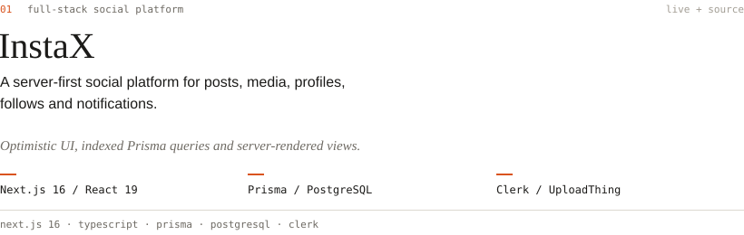
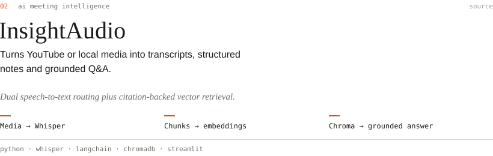
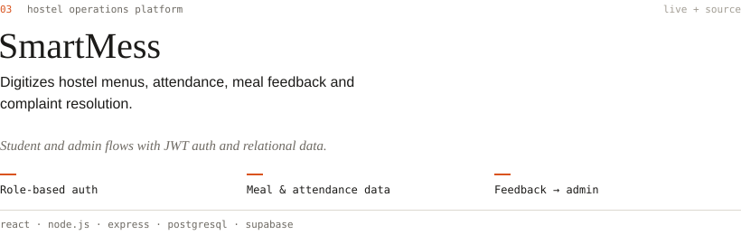
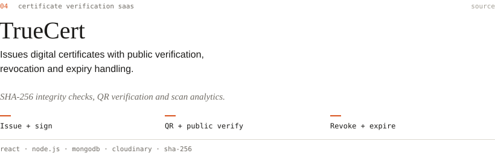
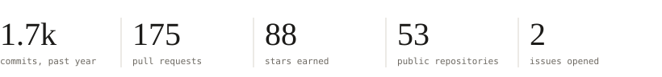
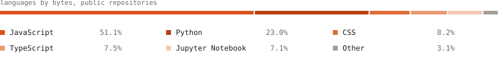
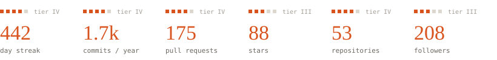
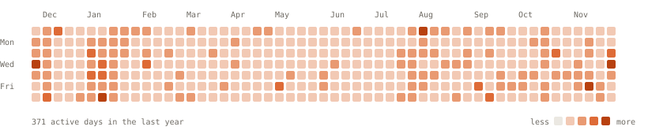
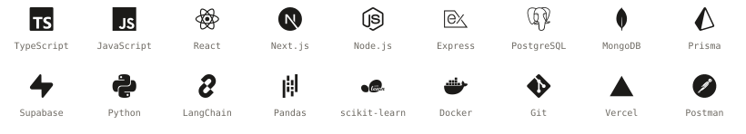
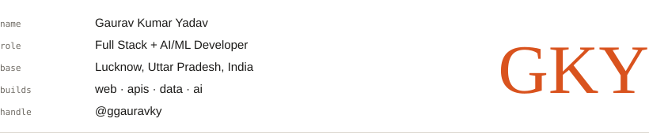

<!-- Generated by scripts/build-readme.py from data/profile.json + this template. Edit those, not README.md. -->

<picture>
  <source media="(prefers-color-scheme: dark)" srcset="./assets/sections/masthead-dark.svg" />
  
</picture>

<a href="https://ggauravky.vercel.app/">Portfolio&nbsp;↗</a>&nbsp;&nbsp;·&nbsp;&nbsp;<a href="https://www.linkedin.com/in/gauravky/">LinkedIn&nbsp;↗</a>&nbsp;&nbsp;·&nbsp;&nbsp;<a href="mailto:kumar.gaurav.yadav2007@gmail.com">Email&nbsp;↗</a>&nbsp;&nbsp;·&nbsp;&nbsp;<a href="https://github.com/ggauravky">GitHub&nbsp;↗</a>

<!-- streak:start -->
<picture>
  <source media="(prefers-color-scheme: dark)" srcset="./assets/generated/streak-dark.svg" />
  
</picture>
<!-- streak:end -->

From interfaces and APIs to data, real-time systems and retrieval — I like owning a product end to end and shipping it.

## What I build

- **Frontend systems** — Responsive product interfaces with clear state. React · Next.js · TypeScript
- **Backend & APIs** — Auth, business logic and reliable REST services. Node.js · Express · REST
- **Data layer** — Schemas and storage shaped around the product. PostgreSQL · MongoDB · Prisma
- **Real-time** — Live messaging, presence and event-driven UX. Socket.IO · WebSockets
- **AI & retrieval** — Grounded retrieval and media-intelligence pipelines. Python · Embeddings · Vector search
- **Shipping** — Repeatable builds and production delivery. Docker · Vercel · Render

## Selected work

<picture>
  <source media="(prefers-color-scheme: dark)" srcset="./assets/projects/instax-dark.svg" />
  
</picture>

[Live ↗](https://instax-g.vercel.app/) · [Source ↗](https://github.com/ggauravky/InstaX)

 

<picture>
  <source media="(prefers-color-scheme: dark)" srcset="./assets/projects/insightaudio-dark.svg" />
  
</picture>

[Source ↗](https://github.com/ggauravky/InsightAudio)

 

<picture>
  <source media="(prefers-color-scheme: dark)" srcset="./assets/projects/smartmess-dark.svg" />
  
</picture>

[Live ↗](https://smartmesslms.vercel.app/) · [Source ↗](https://github.com/ggauravky/SmartMess)

 

<picture>
  <source media="(prefers-color-scheme: dark)" srcset="./assets/projects/truecert-dark.svg" />
  
</picture>

[Source ↗](https://github.com/ggauravky/TrueCert)

## On GitHub

<picture>
  <source media="(prefers-color-scheme: dark)" srcset="./assets/generated/stats-dark.svg" />
  
</picture>

<picture>
  <source media="(prefers-color-scheme: dark)" srcset="./assets/generated/languages-dark.svg" />
  
</picture>

<picture>
  <source media="(prefers-color-scheme: dark)" srcset="./assets/generated/trophies-dark.svg" />
  
</picture>

<picture>
  <source media="(prefers-color-scheme: dark)" srcset="./assets/generated/contribution-dark.svg" />
  
</picture>

<picture>
  <source media="(prefers-color-scheme: dark)" srcset="./assets/generated/snake-dark.svg" />
  
</picture>

## Stack

<picture>
  <source media="(prefers-color-scheme: dark)" srcset="./assets/generated/stack-dark.svg" />
  
</picture>

## Journey

<picture>
  <source media="(prefers-color-scheme: dark)" srcset="./assets/sections/journey-dark.svg" />
  
</picture>

## Now

- Full-stack delivery with Next.js and typed APIs
- Retrieval systems that cite their sources
- Cleaner production workflows — CI, previews, observability

## Identity

<picture>
  <source media="(prefers-color-scheme: dark)" srcset="./assets/sections/colophon-dark.svg" />
  
</picture>

## Connect

<a href="https://www.linkedin.com/in/gauravky/">LinkedIn&nbsp;↗</a>&nbsp;&nbsp;·&nbsp;&nbsp;<a href="https://ggauravky.vercel.app/">Portfolio&nbsp;↗</a>&nbsp;&nbsp;·&nbsp;&nbsp;<a href="mailto:kumar.gaurav.yadav2007@gmail.com">Email&nbsp;↗</a>&nbsp;&nbsp;·&nbsp;&nbsp;<a href="https://leetcode.com/u/gauravky/">LeetCode&nbsp;↗</a>&nbsp;&nbsp;·&nbsp;&nbsp;<a href="https://www.geeksforgeeks.org/profile/gauravky">GeeksforGeeks&nbsp;↗</a>

This page rebuilds itself nightly — snapshots are fetched, validated and committed by <a href="./.github/workflows/update-profile.yml">GitHub Actions</a>.

